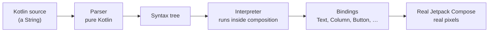
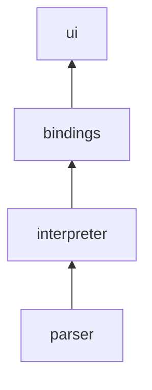

<div align="center">


# Fast Compose

**Instant Jetpack Compose. No compiler, no build, no waiting.**

Write Compose code, see it render in milliseconds, on Android, iOS, desktop and the web.

[](https://central.sonatype.com/namespace/io.github.fast-compose)
[](LICENSE)


</div>

---

## Where you can use Fast Compose

### 🌐 Run Compose anywhere

**[Fast Compose Playground](https://github.com/fast-compose/playground)** runs composables on the web, desktop and
mobile. Write Compose, see it live: no install, no compile server, no waiting.

### ⚡ Faster previews in your IDE

**Plugins for [Android Studio and IntelliJ IDEA](https://github.com/fast-compose/intellij-plugin) and
[VS Code](https://github.com/fast-compose/vscode-extension)** render `@Preview` functions as you type, with no Kotlin
compiler, no Compose compiler plugin and no JVM preview process.

### 🤖 Compose for AI agents

**[compose-cli](https://github.com/fast-compose/compose-cli)** checks and renders Compose previews from the terminal, or
as an MCP server that AI agents call while they write UI code. No Gradle, no compiler, no Android Studio.

### 📄 Compose inside static HTML

**[compose-script](https://github.com/fast-compose/compose-script)** embeds live, editable Compose snippets in any
static page: documentation, blogs, tutorials and design system catalogs.

Add one script to the page:

```html
<script src="https://cdn.jsdelivr.net/npm/@fast-compose/compose-script/compose-script.js"></script>
```

Then write Compose anywhere in the page:

```html
<script type="text/compose-content">
  Column {
    Text("Hello from Compose!")
    Button(onClick = {}) {
      Text("Click me")
    }
  }
</script>
```

### 📦 Dynamic Compose in your apps

**[The Maven library](docs/LIBRARY.md)** renders Compose code at runtime in your Kotlin Multiplatform apps.

```kotlin
val code = rememberComposeCode("""
    @Preview
    @Composable
    fun Hello() {
        Text("Hello from Compose!")
    }
""".trimIndent())

FastComposePreview(code)
```

---

## Contents

- [The problem](#the-problem)
- [How Fast Compose works](#how-fast-compose-works)
- [KMP Library](#kmp-library)
- [Structure](#structure)
- [Building and testing](#building-and-testing)
- [Documentation](#documentation)
- [License](#license)

---

## The problem

Jetpack Compose is a joy to write and a pain to iterate on. Every change, even a padding value, has to go through
the full toolchain before you see a single pixel:

```
On a device:  edit ─▶ compile (Kotlin + Compose compiler plugin) ─▶ dex ─▶ package APK ─▶ install ─▶ run ─▶ 👀
In a preview: edit ─▶ compile (Kotlin + Compose compiler plugin) ─▶ render in a JVM ─▶ 👀
```

Hot reload tools shorten the loop by skipping the restart, but not the compiler:

```
Hot reload:   edit ─▶ compile the changed code ─▶ swap the new classes into the running app ─▶ recompose ─▶ 👀
```

- **Live Edit** (Android Studio) compiles the changed functions and redefines their classes in the app running on a
  device or emulator, then recomposes. Changes to signatures or classes need a full restart.
- **Compose Hot Reload** (JetBrains) recompiles the changed files with Gradle and reloads the classes in a desktop
  JVM app running on the JetBrains Runtime, keeping its state. It works only for the desktop target.

Previews, Live Edit and Compose Hot Reload all still need a compiler, a build and a JVM or device behind them. None of
them can run inside a web page, a documentation site or a lightweight editor.

## How Fast Compose works

Fast Compose skips the compiler entirely. It reads Compose source code like a browser reads HTML:



1. **Parse.** A hand-written Kotlin lexer and parser turn the source into a syntax tree. It is pure Kotlin
   Multiplatform code, with no dependency on the Kotlin compiler, so it runs on Android, iOS, desktop and in the
   browser.
2. **Interpret.** The interpreter walks the tree *inside* a real Compose composition. `remember`, state,
   recomposition, effects and coroutines are the real Compose runtime, not a simulation.
3. **Bind.** When the code calls `Text(...)` or `Modifier.padding(...)`, a binding calls the real Compose API with
   the evaluated arguments. What you see is exactly what Compose draws.

There is no code generation, no bytecode and no server. Edits re-render after a 150 ms typing pause; parsing runs in
the background, and only the changed program is interpreted again.

See [docs/PERFORMANCE.md](docs/PERFORMANCE.md) for measured speed, recomposition and the time limit.

<a id="kmp-library"></a>

## KMP Library [](https://central.sonatype.com/artifact/io.github.fast-compose/fast-compose)

```kotlin
dependencies {
    implementation("io.github.fast-compose:fast-compose:x.y.z")
}
```

Replace `x.y.z` with the latest version, shown above.

Pass Compose code as text, and every `@Preview` in it is rendered:

```kotlin
@Composable
fun App() {
    val code = rememberComposeCode("""
        @Preview
        @Composable
        fun Hello() {
            Text("Hello, Fast Compose!")
        }
    """.trimIndent())

    FastComposePreview(code)
}
```

See [docs/LIBRARY.md](docs/LIBRARY.md) for every composable and option: `FastComposePreview`,
`BasicComposePreview`, `FastComposeContent`, `FastComposeLogs`, registries and your own components, resources,
network images and multiple files.

## Structure

Fast Compose is published as one artifact, `io.github.fast-compose:fast-compose`, for Android, iOS, JVM, JS and Wasm.
Its sources in [`fast-compose`](fast-compose) are grouped by package, in layers:



| Package `ma7moud3ly.fast.compose.*` | Contents |
|---|---|
| `parser` | Kotlin lexer and parser: source code to syntax tree |
| `interpreter` | Runs the syntax tree inside composition; `Registry`, `BindingPack`, multi-file loading, `ExternalResolver` |
| `interpreter.jvm` | JVM only: `JarResolver`, running library code and composables through reflection; `GradleJars` |
| `project` | For hosts: project files (`ProjectFiles`, `DiskFiles`), `KotlinSources`, `FolderSources`, `GradleLayout` |
| `bindings.foundation` | Layouts, text, state, modifiers, drawing, effects, gestures, animation |
| `bindings.material3` | Material 3 components, theming and defaults |
| `bindings.icons` | Material icons (`Icons.Default.*`, `Icons.Filled.*`, `Icons.Outlined.*`, `Icons.AutoMirrored.*`) |
| `bindings.resources` | `R`/`Res`, `painterResource`, `stringResource`, `colorResource`, resource providers |
| `bindings.coil` | Network images: Coil `AsyncImage` and `rememberAsyncImagePainter` |
| `ui` | `FastComposePreview`, `BasicComposePreview`, `FastComposeContent`, `FastComposeLogs`, presets |

Not published: [`binding-check`](binding-check) checks every binding against the AndroidX API files and measures
coverage, and [`app`](app) is the demo app.

## Building and testing

See [docs/BUILDING.md](docs/BUILDING.md) for requirements, running the demo app, tests, benchmarks and releases.

## Documentation

| Document | About |
|---|---|
| [docs/LIBRARY.md](docs/LIBRARY.md) | Every composable and option of the library |
| [docs/BINDINGS.md](docs/BINDINGS.md) | Writing bindings and packs, network images, the binding check |
| [docs/RESOURCES.md](docs/RESOURCES.md) | Images and strings from `R`/`Res`, and where their files come from |
| [docs/MULTIPLE_FILES.md](docs/MULTIPLE_FILES.md) | Previews that use other files of a project |
| [docs/PERFORMANCE.md](docs/PERFORMANCE.md) | Interpreter speed, recomposition, time limit and benchmarks |
| [docs/COVERAGE.md](docs/COVERAGE.md) | What it can run, limitations and Compose API coverage |
| [docs/BUILDING.md](docs/BUILDING.md) | Building, testing, benchmarks and releases |

## License

Fast Compose is licensed under the [Apache License 2.0](LICENSE).
